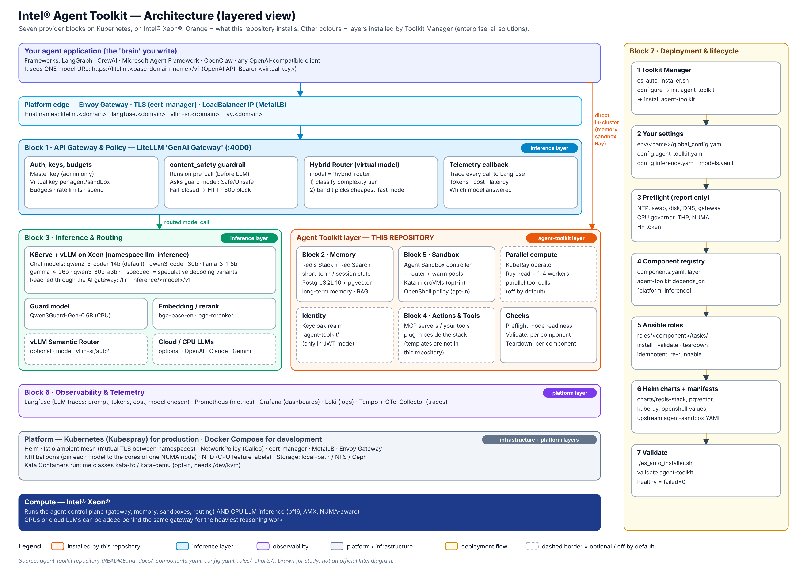
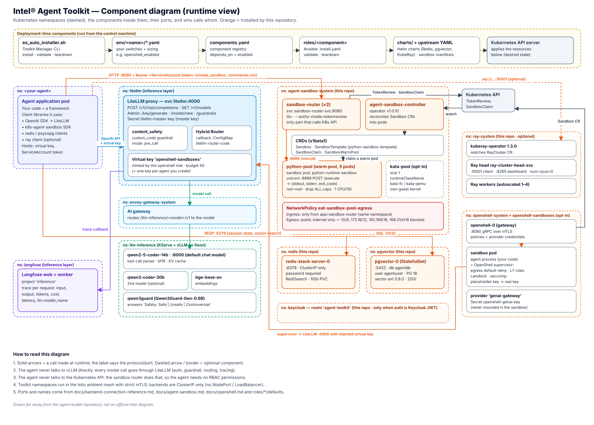
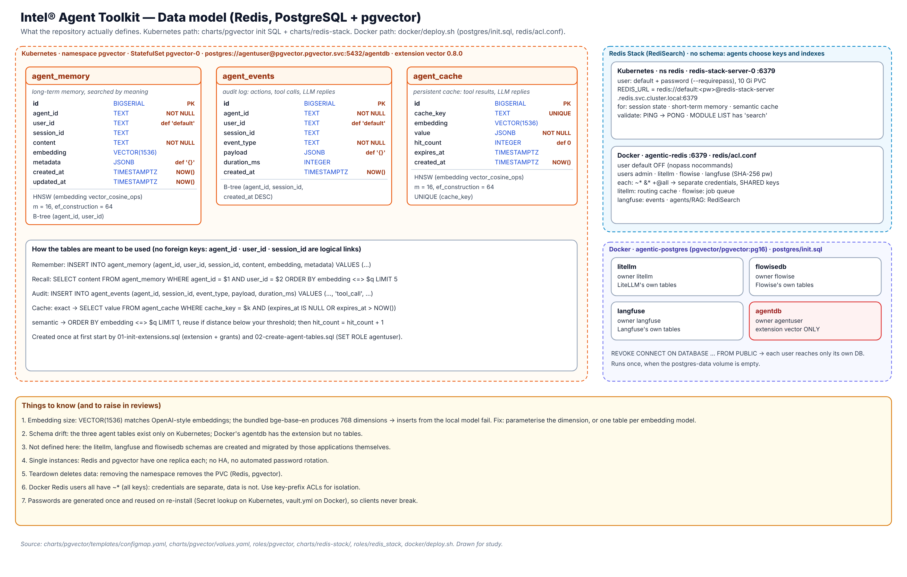
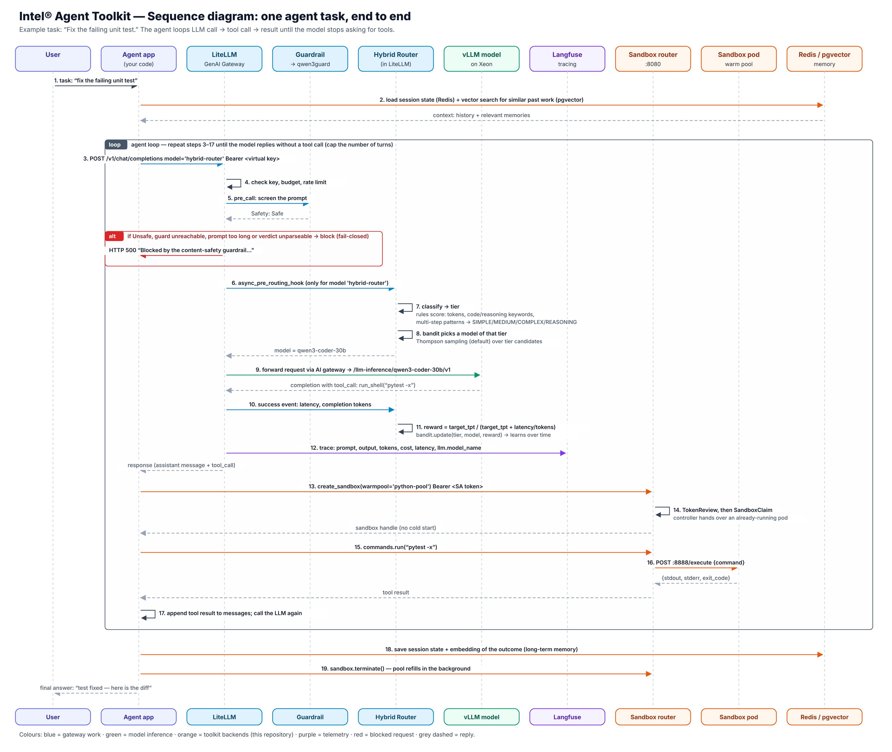

# Intel® Agent Toolkit — Architecture, Design and KPIs

> **Status:** study document, reconstructed from the repository (fork `praveennish/agent-toolkit`
> of `intel/enterprise-agent-toolkit`, documentation for `release-1.2`). It describes the
> system as built. Items marked **(proposed)** are this document's suggestions, not
> statements from the repository.
>
> **Prerequisite:** [`01-understanding-the-agent-toolkit.md`](01-understanding-the-agent-toolkit.md)
> (vocabulary and concepts). The decisions behind this design are recorded in [`adr/`](adr/README.md).

## Contents

1. [Context, goals and non-goals](#1-context-goals-and-non-goals)
2. [Architecture overview](#2-architecture-overview)
3. [Component design](#3-component-design)
4. [Key runtime flows](#4-key-runtime-flows)
5. [Deployment design](#5-deployment-design)
6. [Cross-cutting concerns](#6-cross-cutting-concerns)
7. [KPIs — what to measure and why](#7-kpis--what-to-measure-and-why)
8. [Trade-offs, risks and known limitations](#8-trade-offs-risks-and-known-limitations)
9. [Extension points](#9-extension-points)
10. [Decision index](#10-decision-index)

---

## 1. Context, goals and non-goals

### 1.1 Problem statement

Enterprises want to run AI agents (programs that loop *LLM call → tool call → observe*)
in production, on their own infrastructure. A production agent needs far more than a model:
governed model access, cost control, safe code execution, memory, content safety,
observability and repeatable deployment. Assembling these from open-source parts takes
months (README: *"3–6 months"* from scratch).

### 1.2 Goals

| # | Goal | Evidence in repo |
|---|---|---|
| G1 | **Time-to-production in hours**: one automated install | `es_auto_installer.sh install agent-toolkit`; 20–40 min on a fresh node |
| G2 | **CPU-first**: run the control plane and useful LLM inference on Intel® Xeon®; GPU/cloud optional | CPU model catalog, NUMA-aware vLLM sizing, FAQ "Does it require a GPU? No." |
| G3 | **Pluggable**: every functional block replaceable without touching others | Provider Design Pattern; per-component `*_enabled` switches |
| G4 | **Secure by default** | Fail-closed guardrail, sandbox NetworkPolicies, TokenReview, ClusterIP-only backends, mesh mTLS, generated secrets |
| G5 | **Observable**: every token, latency and agent step captured | Langfuse callback, Prometheus/Grafana/Loki/Tempo |
| G6 | **Framework-neutral** | OpenAI-compatible API; LangGraph, CrewAI, Microsoft Agent Framework, OpenClaw, Flowise |
| G7 | **Private / on-prem / air-gappable** | No mandatory external dependency at runtime; data residency |

### 1.3 Non-goals

- Agent logic, prompts, planning: provided by the customer's framework.
- Model training or fine-tuning.
- Ready-made business agents or MCP tool templates (README: *"not pre-bundled"*).
- A proprietary runtime: everything is a standard open-source component.

### 1.4 Stakeholders

| Stakeholder | Cares about |
|---|---|
| Platform / DevOps engineer | Install, upgrade, validate, teardown; sizing; failure diagnosis |
| Agent developer | One endpoint, SDKs for sandbox/memory, low latency |
| Security / compliance | Isolation, credential handling, audit trail, data residency |
| Finance / product owner | Cost per task, GPU dependency, time to value |
| Intel (vendor) | Xeon adoption for AI, ecosystem growth (see `01-…` Q2) |

---

## 2. Architecture overview



### 2.1 Layers

The product is installed by **Toolkit Manager** (`intel/enterprise-ai-solutions`) as an
ordered set of layers. This repository is the top layer.

| Layer | Contents | Owner |
|---|---|---|
| Infrastructure | Kubernetes (Kubespray), storage (local-path/NFS/Ceph), Kata runtime classes | enterprise-ai-solutions |
| Platform | Envoy Gateway, cert-manager, MetalLB, Istio ambient, PostgreSQL, SeaweedFS, NRI balloons, NFD, observability, Keycloak | enterprise-ai-solutions |
| Inference | KServe, vLLM model services, LiteLLM, Hybrid Router, guardrail, Langfuse, vLLM Semantic Router | enterprise-ai-solutions (inference layer) |
| **Agent toolkit** | **Redis Stack, pgvector, Agent Sandbox (+Kata template), OpenShell, KubeRay, Keycloak realm, preflight, Docker path, docs** | **this repository** |

`components.yaml` encodes the contract:

```yaml
layers:
  - name: agent-toolkit
    enabled: "{{ agent_toolkit_enabled | default(true) | bool }}"
    depends_on: [platform, inference]
components:
  - { name: openshell, layer: agent-toolkit, depends_on: [agent_sandbox], enabled: "{{ openshell_enabled | default(false) }}" }
  # redis_stack, pgvector, keycloak_agent_config, agent_sandbox, kuberay: depends_on: []
```

Cross-layer ordering is handled by layer order; only same-layer dependencies are declared.

### 2.2 The seven provider blocks

Each block is a **capability contract** with an Intel-validated default provider.

| # | Block | Contract (what) | Default provider (how) | Interface consumers depend on |
|---|---|---|---|---|
| 1 | API Gateway & Access Control | Authenticate, authorise, rate-limit, account every model call | LiteLLM | OpenAI HTTP API `/v1/*` + Bearer key |
| 2 | Memory, State & Context | Short-term session state; long-term semantic memory | Redis Stack + RediSearch; PostgreSQL 16 + pgvector | Redis protocol `:6379`; PostgreSQL `:5432` |
| 3 | Intelligent Inference Routing | Send each request to the most suitable model | Hybrid Router; vLLM Semantic Router (opt); vLLM/SGLang | Virtual model names `hybrid-router`, `vllm-sr/auto` |
| 4 | Actions & Tools | Governed tool access | MCP servers (pattern), ETL/ingestion | MCP |
| 5 | Code Execution & Sandbox | Run untrusted code with bounded blast radius | kubernetes-sigs/agent-sandbox; Kata; NVIDIA OpenShell (opt) | Sandbox router HTTP `:8080` + SDK; OpenShell CLI/gRPC |
| 6 | Observability & Telemetry | Capture traces, metrics, logs | Langfuse, Prometheus, Grafana, Loki | OTel / LiteLLM callbacks |
| 7 | Deployment & Orchestration | Provision, scale, update, tear down | Ansible + Helm + Kubernetes; Docker Compose | `es_auto_installer.sh`, `env/<name>/*.yaml` |

Because consumers depend only on the **interface column**, a provider can be replaced
(e.g. another OpenAI-compatible gateway, another vector DB with the same client usage) without
changing the agent. See [ADR-001](adr/ADR-001-provider-design-pattern.md).

### 2.3 Runtime component view



Namespaces and endpoints (from `docs/backend-connection-reference.md` and role defaults):

| Namespace | Component | Endpoint | Exposure |
|---|---|---|---|
| `litellm` | LiteLLM proxy | `litellm.litellm.svc:4000`; external `https://litellm.<domain>` | Gateway route (TLS) |
| `envoy-gateway-system` | AI gateway | `ai-gateway…/llm-inference/<model>/v1` | in-cluster |
| `llm-inference` | vLLM model services | `<model>-kserve-workload-svc…:8000` | in-cluster |
| `langfuse` | Langfuse | `https://langfuse.<domain>` | Gateway route |
| `redis` | Redis Stack | `redis-stack-server.redis.svc:6379` | ClusterIP only |
| `pgvector` | PostgreSQL + pgvector | `pgvector.pgvector.svc:5432`, db `agentdb` | ClusterIP only |
| `agent-sandbox-system` | sandbox-router, controller, sandbox pods | `sandbox-router-svc.agent-sandbox-system.svc:8080` | ClusterIP only |
| `ray-system` | Ray head / workers | `ray://ray-cluster-head-svc.ray-system.svc:10001`, dashboard `:8265`, `https://ray.<domain>` (basic auth) | ClusterIP + optional route |
| `openshell-system` | OpenShell gateway | `openshell.openshell-system.svc:8080` (gRPC, mTLS) | ClusterIP; admin via port-forward |
| `openshell-sandboxes` | OpenShell sandbox pods | — | — |
| `vllm-semantic-router-system` | vLLM-SR dashboard | `https://vllm-sr.<domain>` | Gateway route |

---

## 3. Component design

Each component below follows one template: **Responsibility · Design · Configuration ·
Failure handling · Security.**

### 3.1 GenAI Gateway (LiteLLM), inference layer

- **Responsibility.** Single entry point for every model call: key validation, per-key
  model lists, budgets, rate limits, spend tracking, model registry, callbacks.
- **Design.** Stock LiteLLM proxy image. State in PostgreSQL + Redis (platform layer).
  Models registered in `model_list` or at runtime via `POST /model/new`
  (`store_model_in_db`). Backends reached through the AI gateway
  (`/llm-inference/<model>/v1`).
- **Auth modes.** `auth_provider: "litellm"` (virtual keys; the default for this toolkit) or
  Keycloak JWT (`auth_type: jwt`, then the `keycloak_agent_config` role creates the
  `agent-toolkit` realm).
- **Security.** The master key stays in Secret `litellm-master-key`. OpenShell mints its own
  virtual key *inside* the LiteLLM pod, so the master key never leaves it.
  `litellm_allowed_namespaces` lists which mesh namespaces may call LiteLLM.

### 3.2 Hybrid Router, inference layer

- **Responsibility.** Expose a *virtual* model (`hybrid-router`) and rewrite each request to
  the most efficient real model for its complexity.
- **Design.** Two layers:
  1. **Classifier** (rules, no model call): weighted score over estimated tokens, code /
     reasoning / technical / simple keywords, multi-step patterns, question density →
     `SIMPLE` (< 0.15), `MEDIUM` (0.15–0.35), `COMPLEX` (0.35–0.60), `REASONING`
     (≥ 0.60 or 2+ reasoning markers).
  2. **Per-tier multi-armed bandit** over `tier_candidates`: Thompson sampling (default),
     UCB (`delta`), or ε-greedy (`epsilon`). Reward
     `target_tpt / (target_tpt + latency/max(tokens,1))`, failure = 0, optional blend with
     `quality_weight`. A tier with one candidate skips the bandit.
- **Integration (no image rebuild).** Router source rendered into ConfigMap
  `litellm-router-code`, mounted into the LiteLLM container. Registered as callback
  `custom_hybrid_router.proxy_handler_instance`, which monkey-patches
  `litellm.router.Router` to recognise the `auto_router/hybrid_router` prefix and hooks
  `async_pre_routing_hook`. Requests for other model names are untouched.
- **Learning loop.** `async_log_success_event` / `async_log_failure_event` → reward →
  `bandit.update()`. State exposed by `HybridRouterProxy.router_state()`.
- **Configuration.** `hybrid_router_enabled` (default `true`); `hybrid_router_config`
  (`bandit`, `delta`, `epsilon`, `target_tpt`, `quality_weight`, `tier_candidates`,
  `tier_priors`, `complexity_router_config`); `hybrid_router_default_model`.
- **Design note (analysis).** With the default `target_tpt = 1.0` s/token and typical CPU
  time-per-token well under 0.2 s, rewards cluster near 1.0 (0.02 s → 0.980; 0.2 s → 0.833).
  Differences between models are then small, and the bandit needs more samples to separate
  them. Setting `target_tpt` near the observed time-per-token spreads the reward curve.
  **(proposed tuning)**
- See [ADR-004](adr/ADR-004-hybrid-router-classifier-plus-bandit.md).

### 3.3 Content-safety guardrail, inference layer

- **Responsibility.** Screen every chat request *before* it reaches the main LLM.
- **Design.** Guard model `qwen3guard` (`Qwen/Qwen3Guard-Gen-0.6B`) served by a separate vLLM
  release (`vllm-guard`) in `llm-inference`. A LiteLLM **`custom_code`** guardrail named
  `content_safety` (model-agnostic identity) runs on `pre_call`. The code is compiled with
  RestrictedPython: no imports, no classes, injected primitives only (`http_post`,
  `json_parse`, `allow`, `block`, …).
- **Failure handling.** **Fail-closed**: guard unreachable, non-2xx, prompt longer than the
  guard's context, or unparseable verdict → block, each with a distinct message. A blocked
  request returns **HTTP 500** with the reason in `error.message` (fixed LiteLLM behaviour).
  `Controversial` is advisory unless `guard_block_on_controversial: true`.
- **Operations.** Registration is an **upsert** (`PUT /guardrails/{id}`): re-running updates the
  code in place, without a gateway restart. The code is compile-checked via
  `POST /guardrails/test_custom_code` before registration. The guard vLLM uses the
  **Recreate** strategy (RollingUpdate would need double CPU on a busy node).
- **Sizing.** Peak ~8.6 GiB; 4 GiB KV cache gives 37,376 tokens ≥ 32,768 context. The guard's
  context must be ≥ the served model's context, or the guard silently becomes the request-size
  ceiling.
- See [ADR-008](adr/ADR-008-fail-closed-guardrail.md).

### 3.4 LLM inference (vLLM on KServe), inference layer

- **Responsibility.** Serve chat, embedding, reranking and guard models on Xeon.
- **Design.** One KServe service per model. Per-model tuning in `env/<name>/models.yaml`:
  `cpu` (number or `auto`), `memory`, `args` (vLLM flags), `env`
  (`VLLM_CPU_KVCACHE_SPACE`, …), optional `draft_model_id` for speculative decoding.
  Tool-call parser per family: `llama3_json`, `hermes`, `qwen3_xml`, `gemma4`.
- **CPU placement.** NRI balloon policy. `cpu: auto` takes the free physical cores of one NUMA
  node per TP rank. TP auto-selected among 1/2/4 by topology. Models must not span NUMA nodes
  at TP=1 (`shm.cpp thread_num mismatch`).
- **Memory.** TP=1 → limit 200 GiB (stays on one NUMA node; larger makes NRI widen
  `cpuset.mems` and vLLM fails to bind cores). TP ≥ 2 → limit 400 GiB. Footprint ≈ weights +
  TP × KV + runtime (table in `01-…` §4.4).
- See [ADR-003](adr/ADR-003-cpu-first-inference-on-xeon.md) and
  [ADR-012](adr/ADR-012-numa-aware-cpu-pinning.md).

### 3.5 Memory: Redis Stack (this repo, `roles/redis_stack`)

- **Responsibility.** Short-term memory: session state, semantic cache, RediSearch vector
  index; shared by all agents.
- **Design.** Vendored Helm chart `charts/redis-stack` (subchart `redis-stack-server`); one
  persistent instance (10 Gi PVC) in namespace `redis`.
- **Security.** Authentication mandatory (the chart refuses to render without a password).
  The password is generated once (24 chars) and **reused on re-runs** from Secret
  `redis-stack-server-credentials` (`REDIS_PASSWORD`, `REDIS_URL`). Service is ClusterIP;
  NetworkPolicy allows the Redis port and the Istio HBONE port `15008`. The URL must use the
  `default:` user (Redis 6+ rejects `redis://:<pw>@`).
- **Resilience of the installer.** Detects a *failed* previous Helm release and removes it
  first (`helm upgrade --install` cannot recover a failed first release). Install errors are
  captured (`ignore_errors`) and turned into a clear `assert` message, with `no_log` so
  secrets never print.
- **Validation.** Pod running, `PING` → `PONG`, `MODULE LIST` contains `search`.

### 3.6 Memory: PostgreSQL + pgvector (this repo, `roles/pgvector`)

- **Responsibility.** Long-term memory, RAG embeddings, structured agent state.
- **Design.** Chart `charts/pgvector` (StatefulSet, image `pgvector/pgvector:pg16`), namespace
  `pgvector`, db `agentdb`, user `agentuser`, 20 Gi, resources 250m–2 CPU / 512 Mi–2 Gi,
  optional `pgvector_parameters` (e.g. `max_connections`).
- **Operations.** Password reused across runs (also recovers from a failed first install
  where only the chart's Secret exists). Helm timeout 15 min (first `initdb` on NFS ≈ 5 min).
  Verifies `CREATE EXTENSION vector` is active. Publishes Secret `pgvector-credentials` with
  `DATABASE_URL`.

### 3.7 Agent Sandbox (this repo, `roles/agent_sandbox`)

- **Responsibility.** Ephemeral, isolated execution environments for agent-generated code.
- **Design.**
  - Upstream `kubernetes-sigs/agent-sandbox` **v1.0.10**: CRDs `Sandbox`, `SandboxTemplate`,
    `SandboxClaim`, `SandboxWarmPool` (v1beta1) and the controller, applied from the official
    release manifest.
  - **sandbox-router** (Go, ×2 replicas, PDB): the *only* component that calls the Kubernetes
    API. The role rewrites the upstream manifest to pin the image and add
    `--authz-mode=tokenreview --authz-tokenreview-require-token=true`, so every request needs a
    valid ServiceAccount token (else `401`). Clients therefore need **no RBAC**.
  - **Template** `python-sandbox-template`: image `python-runtime-sandbox:v1.0.10`, FastAPI on
    `:8888` `POST /execute {command}` → `{stdout, stderr, exit_code}`; non-root uid 1000,
    `allowPrivilegeEscalation: false`, `drop: [ALL]`, 250m/256 Mi → 1 CPU/1 Gi; headless
    Service per pod.
  - **Warm pool** `python-pool`, 5 replicas: `create_sandbox` gets a running pod immediately;
    the pool refills in the background.
  - **NetworkPolicy `eat-sandbox-pool-egress`**: selects every sandbox pod by the label that
    survives claiming (`agents.x-k8s.io/sandbox-name-hash`). Ingress only from
    `app=sandbox-router`. Egress to public addresses only (RFC 1918, link-local, IPv6 ULA and
    link-local blocked), so code cannot reach the node, the Kubernetes API or cluster services.
    *Why the extra policy:* the controller's own template policies select a label that warm-pool
    pods never carry.
  - **Kata (opt-in)**: if `kata_containers_enabled` and kata-deploy created `kata-fc` (preferred)
    or `kata-qemu`, the role adds `kata-sandbox-template` (same image, different
    `runtimeClassName`, node label `ei-kata-eligible`) and `kata-pool` (size 1, because microVMs
    cost more). No readiness gate on the Kata pool, so one bad node cannot hang the install.
- **SDK usage.** `k8s-agent-sandbox==1.0.10`; Direct mode (in-cluster URL) or Tunnel mode
  (auto port-forward). The token is added to `sandbox.connector.session.headers`. Session
  pattern: reuse one sandbox across tool calls for state (installed packages).
- See [ADR-006](adr/ADR-006-agent-sandbox-with-warm-pools.md) and
  [ADR-007](adr/ADR-007-layered-isolation-kata-openshell.md).

### 3.8 OpenShell (this repo, `roles/openshell`, opt-in)

- **Responsibility.** Policy-enforced sandboxes: egress default-deny, per-host/per-binary
  allow rules, L7 (HTTP method/path) rules, Landlock + seccomp, **credential isolation**.
- **Design.** NVIDIA OpenShell 0.1.6 Helm chart. The gateway (`openshell-0`, gRPC/mTLS
  `:8080`) creates `agents.x-k8s.io` `Sandbox` CRs, reconciled by the *same* Agent Sandbox
  controller (both paths coexist). A supervisor inside each sandbox pod enforces policy.
- **GenAI Gateway provider.** The role (task group 3):
  1. Admits sandboxes to LiteLLM under STRICT mTLS (a per-workload exception; LiteLLM still
     requires the key).
  2. Mints virtual key `openshell-sandboxes` (budget 50) by `kubectl exec` into the LiteLLM
     pod; the master key never leaves the pod. Stores it in Secret `openshell-genai-key`.
  3. Downloads the CLI into a private, versioned directory (mode 0700), registers provider
     profile `eat-genai-gateway` and provider `genai-gateway` through a temporary port-forward,
     then **deletes the CLI credentials**.
  - Inside the sandbox, `OPENAI_API_KEY` is a placeholder (`openshell:resolve:env:…`). The
    supervisor swaps in the real key only for the allowed LiteLLM endpoint and only for
    allow-listed binaries (`/usr/bin/curl`, python, OpenCode).
- **Defence in depth.** NetworkPolicy `eat-openshell-sandbox-pods`: ingress only from
  `openshell-system`; egress only to DNS, the OpenShell gateway, LiteLLM `:4000`, the proxy
  port on `openshell_upstream_proxy_cidrs`, and public addresses.
- **Auth.** Single-admin mode by default: ClusterIP gateway, access gated by Kubernetes RBAC
  (port-forward + client cert). OIDC is possible but not yet validated.

### 3.9 KubeRay (this repo, `roles/kuberay`, opt-in)

- **Responsibility.** Distributed Python compute for parallel tool execution.
- **Design.** KubeRay operator 1.3.0 + `RayCluster` from `charts/kuberay`. The head has
  `num-cpus=0` (scheduling only). Workers autoscale 1–4 (default 2; 500m–2 CPU, 2–4 Gi).
  Affinity prefers `workload-class=platform` nodes and tolerates control-plane taints.
  Dashboard published at `ray.<domain>` behind basic auth (htpasswd Secret
  `ray-dashboard-auth`, created once).
- **Constraint.** The client `ray[default]` version must exactly match the cluster image
  (`2.40.0`).

### 3.10 Preflight (this repo, `playbooks/preflight-check.yml`)

- **Responsibility.** Catch environment problems *before* a 30-minute install fails.
- **Design.** Play 1 runs per node: network layer and platform-health layer. Play 2 aggregates
  results, merges them into a cumulative report (JSON / HTML / TXT), and prints a
  `PREFLIGHT WARNING` block. **Report-only**: nothing stops the install; capped at 5 minutes.
  Its only change to a system is the kubelet DNS fix.
- **Checks.** FAIL: time sync, kubelet DNS file, unfinished Kubernetes install, node connection
  (delegation targets the right machine, by comparing machine IDs), swap, root/containerd
  disk < 10 %, external DNS, gateway reachability. WARN: CPU governor ≠ `performance`,
  THP = `always`, invalid HF token. PENDING: cluster checks before the cluster exists.
  OK/info: kernel, OS, kubelet, NUMA.
- See [ADR-011](adr/ADR-011-report-only-preflight-and-uniform-validate.md).

### 3.11 Docker Compose path (this repo, `docker/`)

- **Responsibility.** Single-machine development and demos with the same stack shape.
- **Design.** `deploy.sh` reads `docker/config.cfg`, generates secrets (`vault.yml` → `.env`),
  and generates one model container per model (`generate-docker-compose.sh` from
  `model-configs.yaml` or `ovms-model-configs.yaml`) plus `litellm/config.yaml`. Core services:
  shared PostgreSQL (pgvector; separate DBs and least-privilege users for LiteLLM, Flowise,
  Langfuse, agentdb), Redis Stack with an ACL file, LiteLLM `:4000`; Flowise and Langfuse via
  profiles. Serving engine: `vllm` (`/v1`) or `openvino` (`/v3`, int4/int8, conversion on first
  start). Containers drop all capabilities.
- **Security detail.** Flowise binds to loopback until the first owner exists (its register
  endpoint is unauthenticated); afterwards `DENYLIST_URLS` closes it.
- See [ADR-010](adr/ADR-010-kubernetes-for-production-docker-for-development.md).

### 3.12 Data model: Redis, PostgreSQL and pgvector



This section records exactly what the repository **defines** for data. Where something isn't
defined here, it says who owns it.

#### 3.12.1 Redis Stack: no schema, access only

Redis is a key-value store (with the **RediSearch** module for indexing and vector search). The
repository defines **no keys, no key naming convention and no search indexes**. Redis starts empty,
and each agent chooses its own layout. What the repository does define is **who can connect**:

| | Kubernetes (`charts/redis-stack`, `roles/redis_stack`) | Docker (`docker/deploy.sh` → `redis/acl.conf`) |
|---|---|---|
| Instance | StatefulSet `redis-stack-server`, 1 replica, ns `redis`, 10 Gi PVC | Container `agentic-redis`, shared by all services |
| Authentication | Built-in `default` user + password via `--requirepass` (the chart **refuses to render** without a password) | `default` user **disabled**; users `admin`, `litellm`, `flowise`, `langfuse`, passwords stored as SHA-256 |
| Connection | Secret `redis-stack-server-credentials` → `REDIS_URL = redis://default:<pw>@redis-stack-server.redis.svc.cluster.local:6379` | `redis://<user>:<pw>@redis:6379` from `docker/.env` |
| Network | ClusterIP; NetworkPolicy on 6379 (+ Istio HBONE 15008) | Published on host port 6379 |
| Intended use | Agents: session state, short-term memory, semantic cache | LiteLLM routing cache, Flowise job queue, Langfuse events, agents/RAG |
| Validation | `PING` → `PONG`; `MODULE LIST` contains `search` | Healthcheck `redis-cli --user admin … ping` |

**(proposed)** A key convention for agents, so tenants and features don't collide:
`<tenant>:<agent_id>:session:<session_id>` (hash, TTL), `<tenant>:<agent_id>:cache:<sha>` (string or
JSON, TTL), and RediSearch index names prefixed by tenant. On Docker, add key-prefix ACLs
(`~litellm:*` …) so service users can't read each other's data: today every user has
`~* &* +@all`.

#### 3.12.2 PostgreSQL + pgvector on Kubernetes: the agent schema

`charts/pgvector/templates/configmap.yaml` is mounted at `/docker-entrypoint-initdb.d`, so it runs
**once**, when the data directory is first initialised. Database `agentdb`, owner `agentuser`,
service `pgvector.pgvector.svc.cluster.local:5432`, Secret `pgvector-credentials`
(`DATABASE_URL`).

**`01-init-extensions.sql`** enables `vector` and grants `agentuser` all privileges on the
database, on schema `public`, and by default on future tables and sequences.

**`02-create-agent-tables.sql`** (runs as `agentuser` via `SET ROLE`):

| Table | Purpose | Columns | Indexes |
|---|---|---|---|
| `agent_memory` | Long-term memory, searched by meaning | `id BIGSERIAL PK`, `agent_id TEXT NOT NULL`, `user_id TEXT NOT NULL DEFAULT 'default'`, `session_id TEXT`, `content TEXT NOT NULL`, `embedding VECTOR(1536)`, `metadata JSONB NOT NULL DEFAULT '{}'`, `created_at`, `updated_at TIMESTAMPTZ DEFAULT NOW()` | HNSW `(embedding vector_cosine_ops)` with `m = 16, ef_construction = 64`; B-tree `(agent_id, user_id)` |
| `agent_events` | Audit log of every action, tool call or LLM response | `id BIGSERIAL PK`, `agent_id`, `user_id`, `session_id`, `event_type TEXT NOT NULL`, `payload JSONB`, `duration_ms INTEGER`, `created_at` | B-tree `(agent_id, session_id, created_at DESC)` |
| `agent_cache` | Persistent cache of tool results and LLM responses | `id BIGSERIAL PK`, `cache_key TEXT NOT NULL UNIQUE`, `embedding VECTOR(1536)`, `value JSONB NOT NULL`, `hit_count INTEGER DEFAULT 0`, `expires_at TIMESTAMPTZ`, `created_at` | HNSW `(embedding vector_cosine_ops)`; unique `cache_key` |

There are **no foreign keys**: `agent_id`, `user_id` and `session_id` are logical links between the
tables.

**Access patterns the schema supports:**

```sql
-- remember
INSERT INTO agent_memory (agent_id, user_id, session_id, content, embedding, metadata) VALUES ($1,$2,$3,$4,$5,$6);
-- recall: k nearest memories for this agent and user (cosine distance)
SELECT content, metadata FROM agent_memory
 WHERE agent_id = $1 AND user_id = $2
 ORDER BY embedding <=> $3 LIMIT 5;
-- audit a tool call
INSERT INTO agent_events (agent_id, session_id, event_type, payload, duration_ms)
VALUES ($1, $2, 'tool_call', $3, $4);
-- exact cache hit
SELECT value FROM agent_cache WHERE cache_key = $1 AND (expires_at IS NULL OR expires_at > NOW());
-- semantic cache: nearest previous request, reuse below a distance threshold
SELECT value, embedding <=> $1 AS distance FROM agent_cache ORDER BY embedding <=> $1 LIMIT 1;
UPDATE agent_cache SET hit_count = hit_count + 1 WHERE cache_key = $2;
```

📚 HNSW is an approximate nearest-neighbour graph index. `m` (links per node) and
`ef_construction` (build-time candidate list) trade recall against memory and build time; query-time
recall is tuned with `SET hnsw.ef_search`. The values used (16 / 64) are pgvector's defaults.

#### 3.12.3 PostgreSQL on Docker: databases per service

`docker/deploy.sh` writes `postgres/init.sql`, which runs once on an empty `postgres-data` volume in
the shared `agentic-postgres` container (`pgvector/pgvector:pg16`):

| Database | Owner | Contents defined by |
|---|---|---|
| `litellm` | `litellm` | LiteLLM (its own migrations: keys, budgets, spend, models, guardrails) |
| `flowisedb` | `flowise` | Flowise |
| `langfuse` | `langfuse` | Langfuse (traces themselves go to ClickHouse in the Docker path) |
| `agentdb` | `agentuser` | **Only** `CREATE EXTENSION vector`: no agent tables |

`REVOKE CONNECT ON DATABASE … FROM PUBLIC` restricts each user to its own database.

#### 3.12.4 Schemas not defined in this repository

| Database | Owner |
|---|---|
| LiteLLM's database (Kubernetes) | Platform PostgreSQL (platform layer); schema migrated by LiteLLM |
| Langfuse (Kubernetes) | Inference layer; schema managed by Langfuse |

#### 3.12.5 Data-model risks and proposed fixes

| # | Risk | Evidence | Proposed fix |
|---|---|---|---|
| D1 | `VECTOR(1536)` doesn't match the bundled `bge-base-en` (768-d, 📚 model card), so local-model inserts fail | init SQL vs model catalog | `pgvector_embedding_dim` value rendered into the SQL, or one table per embedding model; record the model name in `metadata` |
| D2 | Agent tables exist on Kubernetes but not in Docker | `deploy.sh` init.sql | Reuse the same `02-create-agent-tables.sql` in both paths |
| D3 | Init SQL runs only on first start; no migration path for schema changes | `docker-entrypoint-initdb.d` semantics | Versioned migrations (e.g. a migration job per release) |
| D4 | Single instance, no backup job, no password rotation | charts, docs | Operator with replicas + PITR backups; rotation runbook |
| D5 | Teardown deletes the namespace, so the PVC and its data go too | `teardown.yaml` | `retain_data` flag; document backup before teardown |
| D6 | Docker Redis users share all keys | `acl.conf` `~*` | Key-prefix ACLs per service |
| D7 | `agent_events` and `agent_cache` grow without bound | no retention or partitioning | Time-based partitioning or retention job; purge expired cache rows |

---

## 4. Key runtime flows

### 4.1 Agent task (end to end)



Summary: memory read → LLM call (key check → guardrail → router → vLLM → reward + trace)
→ tool call in a warm sandbox → loop → memory write → sandbox terminate → answer.

### 4.2 Model call through the gateway (detail)

```
client ──HTTPS──► Envoy Gateway ──► LiteLLM :4000
                                     │ 1 validate virtual key, budget, rate limit
                                     │ 2 pre_call guardrail ──► qwen3guard (via AI gateway)
                                     │      Unsafe / error ──► HTTP 500 (fail-closed)
                                     │ 3 model == hybrid-router ? ──► classify → bandit → rewrite model
                                     │ 4 forward ──► AI gateway ──► vLLM <model> :8000
                                     │ 5 success/failure event ──► bandit.update(reward)
                                     └ 6 callback ──► Langfuse trace (tokens, cost, latency, model)
```

### 4.3 Sandbox acquisition

```
agent ── POST create (Bearer SA token) ──► sandbox-router
sandbox-router ── TokenReview ──► K8s API      (401 if invalid/missing)
sandbox-router ── create SandboxClaim ──► K8s API ──► controller binds a warm-pool pod
agent ── commands.run(cmd) ──► router ── POST :8888/execute ──► sandbox pod
pod egress: public internet only · pod ingress: router only
agent ── terminate ──► pod deleted; warm pool refills
```

### 4.4 OpenShell credential isolation

```
agent (in sandbox): Authorization: Bearer openshell:resolve:env:…   (placeholder)
   └─► supervisor: binary allowed? endpoint allowed? ──► replace with real virtual key ──► LiteLLM :4000
   └─► any other host ──► DENIED (logged: "NET:OPEN … DENIED … not allowed by any policy")
   └─► allowed host, disallowed method ──► 403 (logged: "L7_REQUEST deny POST …")
```

### 4.5 Install flow

```
es_auto_installer.sh install agent-toolkit
  → load env/<name>/global_config.yaml, config.inference.yaml, config.agent-toolkit.yaml (last wins)
  → preflight (unless --only or node_preflight_enabled: false)
  → infrastructure → platform → inference layers
  → agent-toolkit layer: for each enabled component in components.yaml (respecting depends_on)
        roles/<c>/tasks/main.yaml → install.yaml
  → validate: ./es_auto_installer.sh validate agent-toolkit   (healthy = failed=0)
```

---

## 5. Deployment design

### 5.1 Topologies

| Option | Stack | Use |
|---|---|---|
| Single-node Kubernetes | K8s + Helm | Pilot, staging, edge |
| Multi-node Kubernetes | Kubespray + Helm (+ KubeRay) | Production, HA, scale-out; needs shared storage (`storage_backend: nfs` / ceph / netapp-trident) |
| Docker Compose | Compose | Development, demos, CI |
| Rack-scale AI fabric | Kubespray + Calico BGP + Rook/Ceph on fabric, one `rack-profile.yaml` | High-speed fabric racks (**not in this release**) |

### 5.2 Configuration model

| File (`env/<name>/`) | Holds |
|---|---|
| `global_config.yaml` | Domain, TLS mode, auth provider, observability, storage, Istio, Kata, proxy, existing cluster |
| `config.inference.yaml` | Inference layer (e.g. `vllm_sr_enabled`) |
| `config.agent-toolkit.yaml` | This layer: component switches, models to auto-deploy, sizes. **Loads last**, so it overrides `guardrails_enabled`, `hybrid_router_enabled`, `litellm_*` |
| `models.yaml` | Model catalog: CPU, memory, vLLM args, env |
| `inventory/hosts.yaml` | Nodes (Kubespray groups); `ansible_connection` must be set per node |

Defaults live in `roles/<c>/defaults/main.yaml`. `config.yaml` overrides them and is seeded
into the env by `init agent-toolkit`.

### 5.3 Sizing rules

- Node memory needed ≈ Σ model `memory` requests + ~17 GiB for the stack + 16 GiB for the
  guard (if guardrails on). The default install is ~131 GiB → does not fit 128 GB; use a 64 GiB
  model (`qwen2-5-coder-7b`, `llama-3-1-8b`) there.
- CPU: each model's `cpu` should be a multiple of TP and within one socket. `cpu: auto` takes
  a whole NUMA node's free cores, so set explicit `cpu:` values to co-locate several models.
- Use the Intel AI Performance Advisor for first estimates, then measure (§7).

---

## 6. Cross-cutting concerns

### 6.1 Security model: defence in depth

| Threat | Control(s) | Layer |
|---|---|---|
| Unauthenticated model use | Virtual keys / JWT; master key only in a Secret | Gateway |
| Runaway spend | Per-key budgets and rate limits | Gateway |
| Harmful prompt | Fail-closed `pre_call` guardrail | Gateway |
| Malicious generated code harms host | Sandbox pod: non-root, drop ALL, no privilege escalation, CPU/mem limits | Sandbox |
| Kernel escape from sandbox | Kata microVM (own guest kernel) | Sandbox (opt-in) |
| Lateral movement / data exfiltration from sandbox | NetworkPolicy: no private ranges, no K8s API; OpenShell egress default-deny + L7 | Network |
| Agent leaks API key | OpenShell placeholder credentials; key minted inside the LiteLLM pod | Sandbox (opt-in) |
| Unauthorised sandbox creation | Router TokenReview with required token; clients hold no RBAC | Sandbox |
| Eavesdropping between services | Istio ambient, strict mTLS | Platform |
| Backend exposure | ClusterIP-only Redis/pgvector/router/OpenShell; port-forward for admin | Platform |
| Weak / leaked infra secrets | Generated 24-char passwords, reused not regenerated; `no_log` on secret tasks | Automation |
| Supply-chain risk in the repo | Pinned images and actions (by SHA), Trivy, Checkov, Bandit, Scorecard, dependency review | CI |

See [ADR-009](adr/ADR-009-defense-in-depth-network-and-mesh.md).

### 6.2 Reliability and operability

- **Idempotent roles**: `state: present`, password reuse, failed-release cleanup, upserts
  (guardrail, OpenShell provider profile). Re-running `install` is the standard fix path.
- **Uniform lifecycle**: `install` / `validate` / `teardown` per component, selected by
  `component_action`.
- **Readiness waits** with retries for every rollout (controller, router, pods, Helm `wait`).
- **Graceful degradation**: optional pieces warn and skip rather than fail the whole install
  (Kata without KVM, OpenShell provider without LiteLLM, Kata pool without a readiness gate).
- **Redundancy**: sandbox-router ×2 with a PDB. Redis and pgvector are single instances
  (a known limitation, §8).

### 6.3 Scalability

| Dimension | Mechanism |
|---|---|
| More inference throughput | More/larger Xeon nodes; more models; TP; speculative decoding; router sends easy work to small models |
| More agents | Stateless gateway; virtual key per agent; ambient mesh admits new namespaces via `litellm_allowed_namespaces` |
| More concurrent code executions | Larger `agent_sandbox_python_warm_pool_size`; more nodes |
| Parallel tool calls | KubeRay workers (min/max autoscaling) |
| Memory/state | Redis/pgvector vertical scaling (single instance today) |

### 6.4 Observability design

- **LLM level:** Langfuse traces from the LiteLLM callback: input, output, tokens, cost,
  latency, `llm.model_name` (shows routing decisions). Project `inference`.
- **System level:** Prometheus Operator, Grafana, Node Exporter, Loki, Tempo, OTel Collector.
- **Decision level:** Hybrid Router log line per request (`tier=SIMPLE -> llama-3-1-8b`);
  OpenShell `DENIED` logs with policy and reason; preflight report; `validate` recap.

---

## 7. KPIs — what to measure and why

KPIs are grouped by the question they answer. **Source** says where the target comes from:
**Doc** = stated in the repository; **(proposed)** = a sensible starting target to confirm by
measurement.

### 7.1 Business / adoption KPIs

| KPI | Definition | How to measure | Target | Source |
|---|---|---|---|---|
| Time to first running agent | From clean node to first successful chat completion | Install log timestamps | Hours (install 20–40 min + model pull 10–15 min) | Doc |
| Install success rate | Installs ending with `validate` `failed=0` / total | CI or field runs | ≥ 95 % | (proposed) |
| GPU dependency | Share of requests served on CPU | Langfuse by model | Majority on CPU | Doc (design intent) |
| Cost per completed task | (Infra cost + token spend) / tasks | LiteLLM spend + infra | Trend down release over release | (proposed) |

### 7.2 Inference KPIs (per model, per server, per concurrency level)

| KPI | Definition | Tool | Target | Source |
|---|---|---|---|---|
| TTFT p50 / p95 | Time to first token | Load generator, Langfuse | Set per use case (interactive coding: p95 within a few seconds) | (proposed) |
| ITL / TPOT | Inter-token latency (time per output token) | Load generator | Faster than reading speed for chat UIs | (proposed) |
| Output tokens/s (per user, aggregate) | Generation throughput | Load generator, vLLM metrics | Record the curve; find the knee | (proposed) |
| Request latency p95 / p99 | End-to-end via gateway | Langfuse / Prometheus | — | (proposed) |
| Max sustainable concurrency | Highest concurrency before p95 TTFT breaks the SLO | Sweep | Documented per model and SKU | (proposed) |
| Memory headroom | Limit − peak RSS per model pod | Prometheus | > 0 always (OOM-kill = exit 137) | Doc (limits) |
| OOMKilled count | Pod restarts with reason OOMKilled | kube-state-metrics | 0 | (proposed) |
| Speculative-decoding gain | Latency(base) / latency(`-specdec`) | A/B test | > 1 | Doc (intent) |

### 7.3 Gateway, router and guardrail KPIs

| KPI | Definition | Tool | Target | Source |
|---|---|---|---|---|
| Gateway overhead | Latency via LiteLLM − latency direct to vLLM (guardrail off) | A/B | Small vs inference time | (proposed) |
| Guardrail overhead | Latency with guardrail − without | A/B | One extra small-model call; verdict ≤ 32 tokens; timeout 60 s | Doc (caps) |
| Guardrail block rate | Blocked / total, split by reason (unsafe / unreachable / too long / unparseable) | Error messages, logs | Unreachable/unparseable ≈ 0 | (proposed) |
| False-positive rate | Legitimate prompts blocked | Labelled sample | Low; drives `guard_block_on_controversial: false` default | Doc (rationale) |
| Router tier distribution | % requests per tier | Router logs | Matches traffic mix | (proposed) |
| Router benefit | Avg latency/cost with `hybrid-router` vs always-largest model | A/B on mixed traffic | Lower, at equal task success | Doc (intent) |
| Bandit convergence | Requests until best arm gets most traffic per tier; regret | `router_state()` | Converges and re-adapts after change | (proposed) |
| Spend per key | LiteLLM spend tracking | LiteLLM UI | ≤ budget (e.g. OpenShell key 50) | Doc |

### 7.4 Sandbox KPIs

| KPI | Definition | Tool | Target | Source |
|---|---|---|---|---|
| Sandbox acquisition latency (warm) | `create_sandbox` → ready | SDK timing | Sub-second order (no scheduling or image pull) | (proposed) |
| Warm-pool hit rate | Claims served from pool / total | Controller metrics | ≈ 100 % at expected peak | (proposed) |
| Pool readiness | READY / SIZE of `python-pool` | `kubectl get sandboxwarmpool` | 5/5 | Doc |
| Kata boot | microVM start time | Pod events | ~125 ms (Firecracker) | Doc |
| Execution success | `exit_code == 0` share for valid commands | SDK | — | (proposed) |
| Policy denials | OpenShell `DENIED` events | `openshell logs` | Only expected denials | Doc (mechanism) |
| Isolation regression tests | Private CIDR, K8s API and node unreachable from sandbox | Automated test | 100 % pass | (proposed) |

### 7.5 Memory KPIs

| KPI | Definition | Tool | Target | Source |
|---|---|---|---|---|
| Redis command latency p99 | Session read/write | Redis INFO / exporter | Low milliseconds | (proposed) |
| Vector query latency p95 | k-NN search in pgvector / RediSearch | App timing | Well below one LLM call | (proposed) |
| Retrieval quality | Recall@k on a labelled set | Offline eval | Tracked per index change | (proposed) |
| Storage utilisation | PVC usage (Redis 10 Gi, pgvector 20 Gi) | Prometheus | < 80 % | (proposed) |

### 7.6 Platform and reliability KPIs

| KPI | Definition | Tool | Target | Source |
|---|---|---|---|---|
| Validate result | Failed tasks in validate recap | `validate agent-toolkit` | `failed=0` | Doc |
| Preflight criticals | FAIL items in report | Preflight report | 0 | Doc |
| Node tuning | Governor = performance, THP ≠ always | Preflight | All nodes | Doc |
| Component availability | Uptime of LiteLLM, router, Redis, pgvector | Prometheus | ≥ 99.9 % for production | (proposed) |
| Re-run safety | Second `install` causes no unintended changes | Ansible recap | 0 unexpected changes | Doc (idempotency intent) |
| Network (rack-scale) | Cross-leaf throughput / RTT | iperf3 / ping | 83.1 Gbit/s / 0.7 ms on 100G | Doc |
| Storage (rack-scale) | Seq write / 4K IOPS | fio | 1.42 GB/s; 29k read / 12.5k write | Doc |

### 7.7 KPI collection plan (proposed)

1. Enable observability (`observability_enabled: true`) and keep Langfuse on.
2. Add a load-test job (e.g. a Workload Services Framework test case, or any OpenAI-compatible
   load generator) that runs the four-path benchmark in `01-…` §4.5 on every release.
3. Export router state and guardrail block reasons as metrics; chart them in Grafana.
4. Add an isolation test suite that runs inside a sandbox and asserts denials.
5. Publish results per Xeon SKU alongside the release notes.

---

## 8. Trade-offs, risks and known limitations

| Topic | Trade-off / risk | Mitigation in repo / suggestion |
|---|---|---|
| CPU-first inference | Lower peak throughput than GPUs for large models | Router, MoE, speculative decoding; GPU/cloud behind the same gateway |
| KV cache memory | Dominates footprint; large models exceed 256 Gi request at TP=4 | Documented footprint table; Burstable QoS with 400 Gi limit; raise ceiling for bigger models |
| Rule-based classifier | Keyword heuristics can misclassify | Tunable boundaries/keywords; bandit corrects *within* a tier; vLLM-SR alternative |
| Reward = speed only by default | May favour fast but weaker models | `quality_weight` blend; careful `tier_candidates` |
| Router monkey-patches LiteLLM | Can break on LiteLLM upgrades | Pinned LiteLLM version; mirrors LiteLLM's own ComplexityRouter |
| Fail-closed guardrail | Guard outage = full outage of chat | Distinct messages; Recreate strategy; capacity planning |
| HTTP 500 for blocks | Clients may treat a block as a server error | Documented: inspect `error.message` |
| Single guard, input only | No output screening, no PII | Roadmap: multiple guardrails (latency adds up, no asyncio in sandbox) |
| Single-instance Redis / pgvector | Not HA | Scale-out / operator-based HA as future work (proposed) |
| No password rotation | Manual rotation only | Documented limitation |
| Sandboxes need public DNS / no proxy | No outbound access on proxied networks | Documented; OpenShell path chains through the corporate proxy |
| OpenShell single-admin mode | Client cert grants full gateway control | Restrict `pods/exec`; OIDC future |
| Features "not in this release" | Docs describe features not installable now | Clearly marked in docs |

---

## 9. Extension points

| To add… | Do this |
|---|---|
| A new chat model | Add to `env/<name>/models.yaml` (cpu, args, tool-call parser, env); `./model-manager deploy <name>`; re-run install so the router includes it |
| A router tier change | Edit `hybrid_router_*` / `tier_candidates`; `install agent-toolkit -- -e litellm_reconcile=true` |
| A guard model | Add a template for its verdict format + a `guard_code_templates` entry; set `guardrail_model` |
| A sandbox runtime (Node, Java…) | Image exposing `POST /execute`; new `SandboxTemplate` + `SandboxWarmPool` |
| A sandbox policy | OpenShell `--policy` YAML (filesystem, landlock, network_policies with L7 access) |
| A new agent namespace | Label it `istio.io/dataplane-mode=ambient`; add it to `litellm_allowed_namespaces` |
| A new toolkit component | New `roles/<name>/` with `main/install/validate/teardown`, defaults, optional chart; register in `components.yaml` with `layer: agent-toolkit` |

---

## 10. Decision index

| ADR | Decision |
|---|---|
| [ADR-001](adr/ADR-001-provider-design-pattern.md) | Provider Design Pattern: pluggable blocks behind standard interfaces |
| [ADR-002](adr/ADR-002-litellm-single-gateway.md) | LiteLLM as the single OpenAI-compatible gateway with virtual keys |
| [ADR-003](adr/ADR-003-cpu-first-inference-on-xeon.md) | CPU-first inference with vLLM on Xeon; GPU/cloud optional |
| [ADR-004](adr/ADR-004-hybrid-router-classifier-plus-bandit.md) | Hybrid Router: rules classifier + per-tier bandit, mounted without image rebuild |
| [ADR-005](adr/ADR-005-two-tier-memory-redis-pgvector.md) | Two-tier memory: Redis (short-term) + pgvector (long-term); schema in §3.12 |
| [ADR-006](adr/ADR-006-agent-sandbox-with-warm-pools.md) | Agent Sandbox with router-only K8s access, TokenReview and warm pools |
| [ADR-007](adr/ADR-007-layered-isolation-kata-openshell.md) | Opt-in stronger isolation: Kata microVMs and OpenShell |
| [ADR-008](adr/ADR-008-fail-closed-guardrail.md) | Fail-closed content-safety guardrail on `pre_call` |
| [ADR-009](adr/ADR-009-defense-in-depth-network-and-mesh.md) | Defence in depth: mesh mTLS, NetworkPolicy, ClusterIP-only |
| [ADR-010](adr/ADR-010-kubernetes-for-production-docker-for-development.md) | Kubernetes for production, Docker Compose for development |
| [ADR-011](adr/ADR-011-report-only-preflight-and-uniform-validate.md) | Ansible roles with uniform install/validate/teardown; report-only preflight |
| [ADR-012](adr/ADR-012-numa-aware-cpu-pinning.md) | NUMA-aware CPU pinning and memory limits for CPU inference |
