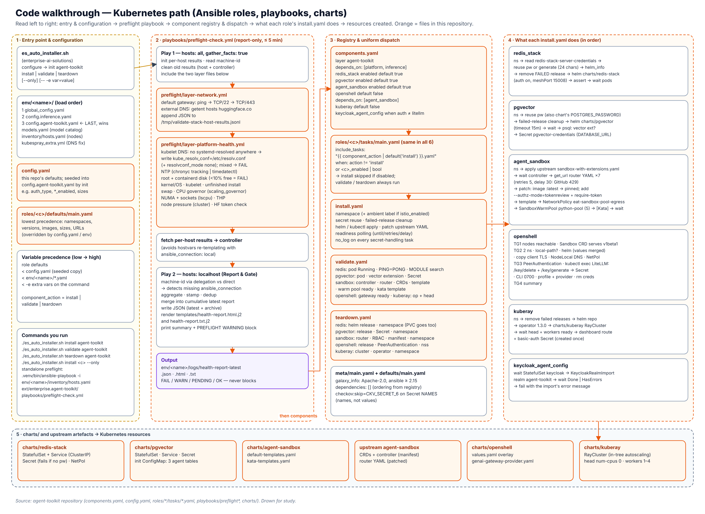
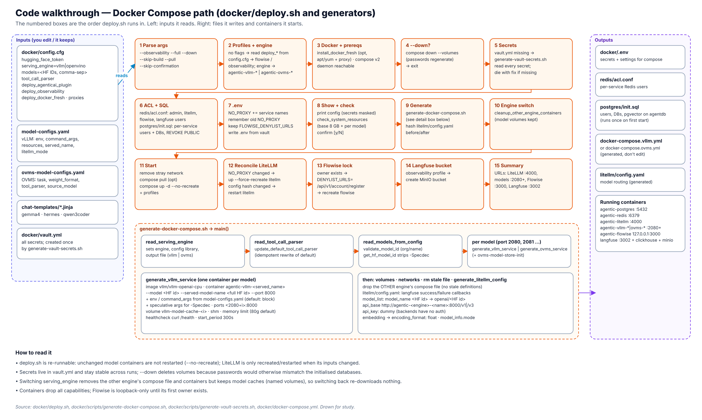

# Code Walkthrough — Intel® Agent Toolkit

> **Goal:** read the repository's code the way its authors run it, file by file and in execution
> order, so you can explain *what happens, where, and why* for any line an interviewer points at.
>
> **Diagrams for this document:**
> [`diagrams/code-map-kubernetes.png`](diagrams/code-map-kubernetes.png) (Ansible/Helm path) and
> [`diagrams/code-map-docker.png`](diagrams/code-map-docker.png) (Docker Compose path).
> Keep them open while reading.
>
> **Conventions:** `path:line` refers to the repository at branch `claude/inspiring-hawking-lzeaaz`
> (based on upstream `b3a2959`). 🔎 marks my analysis. Everything else is what the code does.

## Contents

1. [Map of the code](#1-map-of-the-code)
2. [Suggested reading order](#2-suggested-reading-order)
3. [Walkthrough A — `install agent-toolkit` on Kubernetes](#3-walkthrough-a--install-agent-toolkit-on-kubernetes)
   - [3.1 Entry point and configuration](#31-entry-point-and-configuration)
   - [3.2 Preflight playbook](#32-preflight-playbook)
   - [3.3 Component registry and dispatch](#33-component-registry-and-dispatch)
   - [3.4 `redis_stack`](#34-redis_stack)
   - [3.5 `pgvector`](#35-pgvector)
   - [3.6 `agent_sandbox`](#36-agent_sandbox)
   - [3.7 `openshell`](#37-openshell)
   - [3.8 `kuberay`](#38-kuberay)
   - [3.9 `keycloak_agent_config`](#39-keycloak_agent_config)
   - [3.10 Validate and teardown](#310-validate-and-teardown)
4. [Walkthrough B — the Helm charts](#4-walkthrough-b--the-helm-charts)
5. [Walkthrough C — `docker/deploy.sh`](#5-walkthrough-c--dockerdeploysh)
6. [Walkthrough D — CI workflows](#6-walkthrough-d--ci-workflows)
7. [Trace exercises (follow one value end to end)](#7-trace-exercises-follow-one-value-end-to-end)
8. [Patterns to recognise anywhere in the code](#8-patterns-to-recognise-anywhere-in-the-code)
9. [Findings from reading the code](#9-findings-from-reading-the-code)
10. [What is *not* in this repository](#10-what-is-not-in-this-repository)

---

## 1. Map of the code

```
agent-toolkit/
├── components.yaml                     ← layer + component registry read by Toolkit Manager
├── config.yaml                         ← default switches, seeded into env/<name>/config.agent-toolkit.yaml
├── roles/                              ← one Ansible role per component (≈ 1,000 lines of tasks)
│   ├── redis_stack/      {defaults,meta,tasks/{main,install,validate,teardown}}.yaml
│   ├── pgvector/         …
│   ├── agent_sandbox/    …
│   ├── openshell/        …   (largest: install.yaml 429 lines)
│   ├── kuberay/          …
│   └── keycloak_agent_config/ …
├── charts/
│   ├── redis-stack/      Chart + vendored subchart redis-stack-server (StatefulSet, Service, Secret, NetworkPolicy)
│   ├── pgvector/         StatefulSet, Service, Secret, init ConfigMap (SQL schema)
│   ├── kuberay/          RayCluster template
│   ├── agent-sandbox/    default-templates.yaml, kata-templates.yaml (applied by the role, not Helm)
│   └── openshell/        values.yaml (overlay for NVIDIA's chart), genai-gateway-provider.yaml
├── playbooks/
│   ├── preflight-check.yml             ← 2 plays: per-node checks, then report & gate
│   └── preflight/{layer-network,layer-platform-health}.yml + templates/health-report.{html,txt}.j2
├── docker/                             ← single-machine path (≈ 2,200 lines of Bash)
│   ├── deploy.sh                       ← orchestrator (1,139 lines)
│   ├── scripts/generate-docker-compose.sh   ← model compose + LiteLLM config generator (891 lines)
│   ├── scripts/generate-vault-secrets.sh    ← secrets (158 lines)
│   ├── docker-compose.yml              ← core services
│   ├── model-configs.yaml / ovms-model-configs.yaml / chat-templates/ / litellm/config.yaml
│   └── config.cfg
├── docs/                               ← feature guides
└── .github/workflows/                  ← 7 CI workflows
```

Two execution paths exist, and they share nothing at runtime:

| Path | Entry | Engine | Produces |
|---|---|---|---|
| **Kubernetes** (production) | `es_auto_installer.sh` in enterprise-ai-solutions | Ansible roles + Helm + kubectl | Namespaced Kubernetes resources |
| **Docker** (development) | `docker/deploy.sh` | Bash + yq + docker compose | Containers on one host |

---

## 2. Suggested reading order

| Step | Read | Why first |
|---|---|---|
| 1 | `components.yaml`, `config.yaml` | Know what exists and what's on by default |
| 2 | `roles/redis_stack/tasks/install.yaml` (110 lines) | The simplest role; teaches every repeated pattern |
| 3 | `charts/redis-stack/charts/redis-stack-server/templates/*` | How the role's values become resources |
| 4 | `roles/pgvector/tasks/install.yaml` + `charts/pgvector/templates/configmap.yaml` | Same pattern + the agent schema |
| 5 | `roles/agent_sandbox/tasks/install.yaml` + `charts/agent-sandbox/*` | Upstream manifests, patching, NetworkPolicy, warm pools, Kata |
| 6 | `roles/openshell/tasks/install.yaml` | The most complex role: Helm values merge, key minting, CLI registration |
| 7 | `roles/kuberay/tasks/install.yaml` + `charts/kuberay/templates/raycluster.yaml` | Operator + CR + gateway route |
| 8 | `playbooks/preflight-check.yml` + layers | Report-only checks, two-play design |
| 9 | `roles/*/tasks/{validate,teardown}.yaml` | Lifecycle completeness |
| 10 | `docker/deploy.sh` → `generate-docker-compose.sh` | The other path |
| 11 | `.github/workflows/*` | Quality gates |

---

## 3. Walkthrough A — `install agent-toolkit` on Kubernetes



### 3.1 Entry point and configuration

The installer lives in **another repository** (`intel/enterprise-ai-solutions`), so this repo is
mounted there as `ext/enterprise.agent-toolkit/`. The user runs:

```bash
./es_auto_installer.sh configure
./es_auto_installer.sh init agent-toolkit      # creates env/local/, seeds config.agent-toolkit.yaml from config.yaml
./es_auto_installer.sh install agent-toolkit
```

**Variable precedence (lowest → highest):**

```
roles/<c>/defaults/main.yaml
  < config.yaml  (as seeded into env/<name>/config.agent-toolkit.yaml)
  < env/<name>/global_config.yaml, config.inference.yaml, config.agent-toolkit.yaml (loaded last)
  < -e extra vars   (e.g. -- -e litellm_reconcile=true)
```

`config.yaml:24–30` shows the toolkit overriding inference-layer behaviour:

```yaml
auth_type: "litellm_vkey"
guardrails_enabled: "{{ (auth_provider == 'litellm') if auth_provider is defined
                        else ((auth_type | default('jwt')) == 'litellm_vkey') }}"
hybrid_router_enabled: true
litellm_public_paths: []
```

The comment at `config.yaml:11–12` explains why this works: the file "loads after
config.inference.yaml, so guardrails_enabled, hybrid_router_enabled and litellm_* set here
override the inference layer's values".

### 3.2 Preflight playbook

**File:** `playbooks/preflight-check.yml` (222 lines) + `playbooks/preflight/*.yml`.

**Play 1: "Preflight Check — Node Readiness"** (`:24`, `hosts: all`, `gather_facts: true`)

| Line | Task | What it does |
|---|---|---|
| `:29` | Initialize per-host results | Empty result list per host |
| `:34`, `:45` | Clean previous results | Host file and controller copies |
| `:39` | Read the node's machine id over its own connection | Baseline for the delegation check |
| `:55` | Preflight: Network connectivity | `include_tasks: preflight/layer-network.yml` |
| `:59` | Preflight: Platform health | `include_tasks: preflight/layer-platform-health.yml` |
| `:64` | Fetch per-host results to the controller | Copies `/tmp/validate-stack-host-results.jsonl` |

`layer-network.yml` tests the default gateway with `ping`, falling back to TCP/22 and TCP/443 when
ICMP is blocked, and external DNS with `getent hosts huggingface.co`. Internal DNS is deliberately
skipped (comment at `:24–26`: hosts don't need cluster DNS).

`layer-platform-health.yml` first handles **kubelet DNS** (Kubespray points kubelet at
systemd-resolved's file; if no node runs it, write `kube_resolv_conf: /etc/resolv.conf` to
`kubespray_extra.yml`). Then one shell block per host checks NTP (`chronyc tracking` or
`timedatectl`), root and containerd disk, kernel/OS, kubelet, an unfinished kubeadm install, swap,
the CPU governor (`/sys/devices/system/cpu/cpu0/cpufreq/scaling_governor`), NUMA and sockets
(`lscpu`) and THP (`/sys/kernel/mm/transparent_hugepage/enabled`). Each result is a JSON object with
`layer, check, status, evidence, hint`, e.g. the hint *"Set performance: cpupower frequency-set -g
performance"*. Cluster-wide checks (node pressure, HF token) run once.

Why write results to a file and fetch them? The comment in `layer-network.yml:5–6` says it avoids
"Ansible's hostvars re-templating issue with `ansible_connection: local`".

**Play 2: "Preflight Check — Report & Gate"** (`:73`, `hosts: localhost`)

| Line | Task | What it does |
|---|---|---|
| `:102–:110` | Read machine id through delegation; compare | If they differ, the node lacks `ansible_connection`, so steps "for that node" would run on the installer machine |
| `:122–:137` | Aggregate, stamp, dedup, list layers | One merged result set |
| `:141–:152` | Read and merge the existing latest report | The report is **cumulative** across runs |
| `:159–:177` | Write JSON (latest + archive), render HTML and TXT | `templates/health-report.{html,txt}.j2` |
| `:183` | Display report | Prints the `.txt` summary |
| `:187–:208` | Find critical failures → warn | The `PREFLIGHT WARNING` block; **no `fail`**, so the install continues |

### 3.3 Component registry and dispatch

`components.yaml` registers the layer (`depends_on: [platform, inference]`) and six components.
Each component's `enabled` is a Jinja expression evaluated against your env files. Only
`openshell` declares a same-layer dependency (`depends_on: [agent_sandbox]`).

Every role's entry file has the same 8 lines (`roles/<c>/tasks/main.yaml`):

```yaml
- name: "pgvector | Dispatch action: {{ component_action | default('install') }}"
  ansible.builtin.include_tasks: "{{ component_action | default('install') }}.yaml"
  when: >-
    (component_action | default('install')) != 'install' or
    (pgvector_enabled | default(true) | bool)
```

Read the `when` carefully: it is *true* for any non-install action, so you can still `validate` or
`teardown` a component you have since disabled. It is *true* for `install` only if the component
is enabled.

### 3.4 `redis_stack`

**File:** `roles/redis_stack/tasks/install.yaml` (110 lines). This is the template every other
role follows.

| Line | Task | Explanation |
|---|---|---|
| `:8` | Create namespace | `kubernetes.core.k8s`, `state: present` (idempotent) |
| `:14` | Enrol namespace in the ambient mesh | Label `istio.io/dataplane-mode: ambient`, only `when: istio_enabled` |
| `:27` | Read existing credentials | `k8s_info` on Secret `redis-stack-server-credentials`, `no_log` |
| `:35` | Resolve password | Reuse the stored `REDIS_PASSWORD`, else the generated default (`defaults/main.yaml`: `lookup('password', '/dev/null length=24 chars=ascii_letters,digits')`) |
| `:44` | Check for an existing release | `helm_info`, `failed_when: false` |
| `:52` | Remove a failed release | Only if status is `failed`: `helm upgrade --install` can't recover a failed first release |
| `:60` | Install via Helm | Chart `{{ role_path }}/../../charts/redis-stack`, `wait: true`, `timeout: 10m`; values under the **subchart key** `redis-stack-server:` (comment: "Overrides go under the subchart name") including `networkPolicy.meshPort: 15008`; `register` + `ignore_errors` + `no_log` |
| `:83` | Check Helm install result | `assert` with `fail_msg` from the module's message, so you get a readable error without leaking values |
| `:89` | Wait for pods to be ready | Label `app=redis-stack-server` (the vendored chart doesn't use `app.kubernetes.io/instance`), 60 × 5 s |
| `:105` | Install complete | Prints the URL format and Secret name |

The password-resolution expression (`:35–:42`):

```yaml
_redis_pw: >-
  {{ (_redis_secret.resources[0].data.REDIS_PASSWORD | b64decode)
     if (_redis_secret.resources | default([]) | length > 0 and
         _redis_secret.resources[0].data.REDIS_PASSWORD is defined)
     else redis_stack_password }}
```

**Why it matters:** re-running `install` never changes the password under running clients.

### 3.5 `pgvector`

**File:** `roles/pgvector/tasks/install.yaml` (142 lines). Same skeleton as Redis, with three
differences:

1. **Password recovery after a failed first install** (`:36–:44`): it reads `password` *or* the
   chart's `POSTGRES_PASSWORD`, because a failed install leaves only the chart's Secret and the
   database was already initialised with that password.
2. **Longer timeout** (`:62`, `timeout: 15m`): the comment says first-start `initdb` on NFS takes
   about 5 minutes. It matches the chart's startup probe (10 s × 90).
3. **Post-install** (`:107` and `:117`): runs `psql … SELECT extname, extversion FROM pg_extension
   WHERE extname='vector'` (with `failed_when: false`; it is informational, and `validate` asserts
   it), then creates Secret **`pgvector-credentials`** with `DATABASE_URL`, host, port, database,
   username and password.

Values passed to the chart (`:62–:85`): `auth.{username,password,postgresPassword,database}`,
`persistence.{size,storageClassName}`, `resources`, `postgresql.parameters`.

### 3.6 `agent_sandbox`

**File:** `roles/agent_sandbox/tasks/install.yaml` (259 lines).

| Line | Task | Explanation |
|---|---|---|
| `:11`, `:20` | Namespace + ambient label | Namespace is fixed at `agent-sandbox-system`: upstream manifests and templates hard-code it |
| `:34` | Apply manifest (CRDs + controller with extensions) | `kubernetes.core.k8s src: <release URL>/sandbox-with-extensions.yaml` |
| `:39` | Wait for controller | `readyReplicas == spec.replicas`, 60 × 10 s |
| `:55` | Download sandbox-router manifests | 7 files (`serviceaccount, rbac, rbac-tokenreview, deployment, service, pdb, networkpolicy`) into `/tmp`; `retries: 5, delay: 30` because raw.githubusercontent.com returns 429 |
| `:66` | Read sandbox-router manifests | `slurp` (base64) |
| `:73` | **Apply sandbox-router manifests** | The key hardening step, below |
| `:84` | Wait for router | Same readiness rule |
| `:99`, `:104` | Read + apply default SandboxTemplate | String replaces `AGENT_SANDBOX_VERSION`, sets `imagePullPolicy: IfNotPresent` |
| `:117` | **NetworkPolicy `eat-sandbox-pool-egress`** | Explained below |
| `:146` | Create default python SandboxWarmPool | `replicas: agent_sandbox_python_warm_pool_size` (5); skipped if 0 |
| `:167–:233` | Kata block | Only `when: kata_containers_enabled` |
| `:240` | Wait for all Agent Sandbox pods | No pod outside Running/Succeeded; every container ready |

**The router patch** (`:73–:82`) is a Jinja pipeline over the downloaded files:

```yaml
definition: >-
  {{ _router_manifests.results | map(attribute='content') | map('b64decode')
     | map('replace', 'registry.k8s.io/agent-sandbox/sandbox-router-go:latest', agent_sandbox_router_image)
     | map('replace', '- --cache-enabled=true', _authz_args)
     | map('from_yaml_all') | map('list') | flatten(levels=1) }}
vars:
  _authz_args: "- --cache-enabled=true\n        - --authz-mode=tokenreview\n        - --authz-tokenreview-require-token=true"
```

Step by step: decode each file → pin the image (upstream says `:latest`) → append two flags after
`--cache-enabled=true` (keeping the YAML indentation) → parse every YAML document → flatten into
one list → apply. Result: every router call must carry a valid ServiceAccount token, checked with
the Kubernetes TokenReview API.

**The NetworkPolicy** (`:117–:144`). The comment above it carries the reasoning: *"The
controller's template NetworkPolicies select a label warm-pool sandboxes never carry, and a claimed
sandbox loses its warm-pool label; sandbox-name-hash stays on every sandbox pod for its life."*
So it selects `agents.x-k8s.io/sandbox-name-hash Exists`, allows ingress only from
`app=sandbox-router` in the same namespace, and allows egress only to `0.0.0.0/0` and `::/0`
**except** private, link-local, ULA and IPv6 link-local ranges.

**The Kata block** (`:167–:233`):

```
get RuntimeClasses  →  choose kata-fc if present, else kata-qemu, else ''   (:176)
  '' → debug message, skip                                                     (:184)
  else → slurp charts/agent-sandbox/kata-templates.yaml
       → regex_replace KATA_RUNTIME_CLASS, KATA_NODE_LABEL_KEY, image, pull policy   (:200)
       → assert the template exists (failed_when: no resources)                (:205)
       → SandboxWarmPool kata-pool (size kata_warm_pool_size = 1)              (:214)
```

There's no readiness wait on the Kata pool, which is deliberate (see `docs/agent-sandbox.md`).

### 3.7 `openshell`

**File:** `roles/openshell/tasks/install.yaml` (429 lines), in four task groups.

**TG1, prerequisites** (`:16–:27`): `kubectl get nodes`; then
`kubectl get crd sandboxes.agents.x-k8s.io -o jsonpath='{.spec.versions[*].name}'` with
`failed_when: rc != 0 or 'v1beta1' not in stdout`. This enforces the `agent_sandbox` dependency at
runtime too.

**TG2, gateway** (`:29–:205`):

| Line | Task | Explanation |
|---|---|---|
| `:29` | Create namespaces | `openshell-system`, `openshell-sandboxes` |
| `:42` | Find node-local StorageClass | If `local-path` exists, use it for workspaces (NFS seeding ≈ 16 min) |
| `:52` | **Install OpenShell Helm chart** | `values = file(charts/openshell/values.yaml) | from_yaml | combine(helm_overrides | from_yaml, recursive=True)`. Overrides (Jinja-templated YAML): image tag, `server.sandboxNamespace`, `workspaceStorageClass`, **either** `oidc.{issuer,audience}` **or** `auth.allowUnauthenticatedUsers: true` (single-admin), `upstreamProxy.{url,noProxy}` |
| `:95` | Replicate client TLS secret | `kubectl get … -o json | python3 (strip metadata, set namespace) | kubectl apply -f -`. The comment calls it a "chart gap": supervisors mount it in the sandbox namespace |
| `:110` | Detect NodeLocal DNSCache | Looks for DaemonSets `nodelocaldns` (Kubespray) or `node-local-dns` (upstream) and reads their `-localip` |
| `:124` | Apply sandbox pod NetworkPolicy | `eat-openshell-sandbox-pods`; selects pods **without** `openshell.ai/boundary-role`; egress to DNS, gateway namespace, LiteLLM :4000, proxy port on `openshell_upstream_proxy_cidrs`, public ranges |
| `:198` | Verify gateway ready | StatefulSet rollout |

**TG3, GenAI Gateway provider** (`:207–:411`, inside a `block` with an `always`):

| Line | Task | Explanation |
|---|---|---|
| `:207` | Check GenAI Gateway is deployed | If LiteLLM is absent, the provider is skipped |
| `:222` | Let sandboxes reach LiteLLM under STRICT mTLS | PeerAuthentication `openshell-sandbox-ingress` selecting `app.kubernetes.io/name: litellm` |
| `:240` | Check for existing key Secret | `vk_secret.rc` decides whether to mint |
| `:247` | **Mint LiteLLM virtual key** | `kubectl exec -n litellm deploy/litellm -c litellm -- python -c '<script>'` (below) |
| `:281` | Store LiteLLM virtual key | Secret `openshell-genai-key` (`api_key`), `no_log` |
| `:297–:319` | Resolve `$HOME`; set CLI dir; prepare dirs (0700; fails if another user owns them); fetch CLI tarball | Default `~/.cache/eat/openshell-cli-v0.1.6` |
| `:326` | Write CLI mTLS bundle | From Secret `openshell-client-tls` |
| `:340`, `:346` | Render provider profile; set endpoint | Substitute `GENAI_HOST`, `GENAI_PORT` |
| `:355` | **Register profile and provider through a temporary port-forward** | Script below |
| `:404` | `always:` Remove CLI credentials | Deletes the CLI config dir, even on failure |

The key-minting script (`:258–:274`), runs **inside** the LiteLLM pod:

```python
def post(path, body):
    req = urllib.request.Request("http://127.0.0.1:4000" + path, json.dumps(body).encode(),
        {"Authorization": "Bearer " + os.environ["PROXY_MASTER_KEY"], "Content-Type": "application/json"})
    return json.load(urllib.request.urlopen(req))
try:
    post("/key/delete", {"key_aliases": ["openshell-sandboxes"]})     # alias may outlive the Secret
except urllib.error.HTTPError as e:
    if e.code not in (400, 404): raise
print(post("/key/generate", {"key_alias": "openshell-sandboxes", "models": [], "max_budget": 50})["key"])
```

The master key is read from the pod's own environment and never crosses the network or the Ansible
log.

The provider-registration script (`:356–:396`):

```
kubectl port-forward svc/openshell 0:8080 &      # random local port; trap kills it on EXIT
wait until pf.log shows "Forwarding from 127.0.0.1:<PORT>"
openshell gateway add https://127.0.0.1:<PORT> --local --name eat
if settings has providers_v2_enabled → set it true          (compat with chart ≤ 0.0.116)
export profile eat-genai-gateway (3 tries)
  has resource_version → insert it into the YAML → profile update   (optimistic concurrency)
  "entity was not found" → profile import
  anything else → print and exit 1
provider get genai-gateway → exists?  else provider create --credential OPENAI_API_KEY
  (key piped from the Secret; "already exists" tolerated: a transient get failure must not fail a re-run)
changed_when: 'provider exists' not in stdout
```

**TG4, summary** (`:413`): prints how to connect the CLI and where the mTLS bundle is.

### 3.8 `kuberay`

**File:** `roles/kuberay/tasks/install.yaml` (222 lines).

| Line | Task | Explanation |
|---|---|---|
| `:8`, `:14` | Namespace + ambient label | `ray-system` |
| `:27`, `:35` | Check releases; remove failed | Looped over both releases (operator, cluster) |
| `:48`, `:53` | Helm repo; operator `1.3.0` | `ray-project.github.io/kuberay-helm`, `wait`, 5 min, affinity + tolerations |
| `:68` | Deploy RayCluster | Local chart `charts/kuberay`; all `kuberay_*` sizes passed as values |
| `:97`, `:111` | Wait head; wait workers | Head label `ray.io/node-type=head` Running; cluster `status.state == ready` and ready workers |
| `:127` | Check for the platform gateway | Gateway `eg-gateway` |
| `:136–:213` | Publish the dashboard | Basic-auth Secret created **once** (`:148`: generate password, hash as htpasswd SHA, store); **HTTPRoute** `ray-dashboard` for host `ray.<domain>` → `ray-cluster-head-svc:8265`; Envoy Gateway **SecurityPolicy** with `basicAuth` targeting the route (`:202`) |

### 3.9 `keycloak_agent_config`

**File:** `roles/keycloak_agent_config/tasks/install.yaml` (65 lines): wait for StatefulSet
`keycloak` (`readyReplicas > 0`) → apply `KeycloakRealmImport` (`k8s.keycloak.org/v2beta1`,
realm `agent-toolkit`) → wait until condition `Done` or `HasErrors` is True → if `HasErrors`, `fail`
with the condition's message. It runs only when `auth_provider != 'litellm'`.

### 3.10 Validate and teardown

| Role | `validate.yaml` asserts | `teardown.yaml` removes |
|---|---|---|
| redis_stack | Pod Running; `redis-cli PING` contains `PONG`; `MODULE LIST` contains `search` (password from the Secret, or the pod's env as fallback) | Helm release; namespace (the PVC goes with it, so the data is lost) |
| pgvector | Pod Running; `vector` extension; Secret `pgvector-credentials` exists | Release; credentials Secret; namespace |
| agent_sandbox | Controller and router deployments ready; CRDs; `python-sandbox-template`; warm-pool readiness (warn on 0 ready); Kata template if enabled | Router deployment; router cluster RBAC (`sandbox-router`, `sandbox-router-auth-delegator`); upstream manifest (CRDs + controller); namespace |
| openshell | Gateway ready | Helm release; LiteLLM PeerAuthentication `openshell-sandbox-ingress`; both namespaces |
| kuberay | Operator deployment; head pod | RayCluster release; operator release; namespace |
| keycloak_agent_config | `KeycloakRealmImport` for the realm exists | The `KeycloakRealmImport` |

🔎 OpenShell teardown does **not** delete the LiteLLM virtual key. That's why install deletes by
alias before generating a new one (§3.7).

---

## 4. Walkthrough B — the Helm charts

### `charts/redis-stack/charts/redis-stack-server/`

| File | What to notice |
|---|---|
| `templates/secret.yaml` | Starts with `{{ fail "… password must be set …" }}` if auth is enabled and the password is empty, so an unauthenticated Redis cannot render. Builds `REDIS_URL` with the `default:` user (comment explains `WRONGPASS`) |
| `templates/redis-stack-server.yaml` | Service (type from values, `ClusterIP`) + StatefulSet: `seccompProfile: RuntimeDefault`; container `allowPrivilegeEscalation: false`, `drop: [ALL]`; env `REDIS_PASSWORD` from the Secret; `REDIS_ARGS="--requirepass $(REDIS_PASSWORD)"` (Kubernetes expands `$(VAR)`, and the image appends `REDIS_ARGS` to `redis-server`); `imagePullPolicy: Always`; PVC template |
| `templates/networkpolicy.yaml` | Ingress on the Redis port (+ `meshPort` 15008 when set); from `allowedNamespaces` + own namespace, or from any namespace if the list is empty |
| `values.yaml` | `redis/redis-stack-server:7.4.0-v8`, 1 replica, 1 Gi (the role sets 10 Gi), auth on, NetworkPolicy on |

### `charts/pgvector/`

| File | What to notice |
|---|---|
| `templates/statefulset.yaml` | `fsGroup: 999`; `postgresql.parameters` map → repeated `-c key=value` args; env from Secret `<fullname>-credentials`; data at `/var/lib/postgresql/data` with `subPath: pgdata`; init ConfigMap mounted at `/docker-entrypoint-initdb.d`; probes `pg_isready` (startup 10 s × 90) |
| `templates/configmap.yaml` | `01-init-extensions.sql` (extension + grants) and `02-create-agent-tables.sql` (`agent_memory`, `agent_events`, `agent_cache`; HNSW cosine indexes `m=16, ef_construction=64`; tables created **as `agentuser`** via `SET ROLE`) |
| `values.yaml` | `pgvector/pgvector:pg16`, 10 Gi (role: 20 Gi), 250m/512 Mi → 1 CPU/1 Gi (role: 2/2 Gi), control-plane tolerations |

### `charts/kuberay/templates/raycluster.yaml`

`rayVersion` from `Chart.AppVersion`; `enableInTreeAutoscaling: true`; head `rayStartParams
{num-cpus: "0", dashboard-host: "0.0.0.0"}`, ports 6379 / 8265 / 10001, liveness TCP 6379,
readiness HTTP `/api/version`:8265; worker group with `replicas/minReplicas/maxReplicas`. All
containers are non-root with `drop: [ALL]`.

### `charts/agent-sandbox/` (applied by the role, not Helm)

`default-templates.yaml`: `python-sandbox-template` (B9 of the interview guide). `kata-templates.yaml`:
the same container plus placeholders `KATA_RUNTIME_CLASS` and `KATA_NODE_LABEL_KEY`, pod labels
`sandbox: kata` and `istio.io/dataplane-mode: none`, and a `nodeSelector` on the eligibility label.

### `charts/openshell/`

`values.yaml` is only an **overlay** for NVIDIA's OCI chart: `telemetryEnabled: false`,
`agentSandbox.preflight.enabled: true`, `imagePullPolicy: IfNotPresent`.
`genai-gateway-provider.yaml` is the provider profile, with placeholders the role substitutes.

---

## 5. Walkthrough C — `docker/deploy.sh`



| Step | Lines | What happens |
|---|---|---|
| 1 Parse args | `:37–:67` | `--observability`, `--full`, `--skip-build`, `--pull`, `--down` (also deletes volumes), `--skip-confirmation`, `--help`; anything else → `die` |
| 2 Profiles + engine | `:69–:103` | With no profile flags, read `deploy_agenticai_plugin` → `flowise` and `deploy_observability` → `observability` from `config.cfg` (`_dcfg` strips comments and whitespace). `serving_engine` → container prefix and compose file (`docker-compose.vllm.yml` / `docker-compose.ovms.yml`); invalid → `die`. Profiles deduplicated |
| 3 Docker + prereqs | `:105–:363` | `install_docker_fresh` (only if `deploy_docker_fresh=on`): detect OS family, configure the proxy for apt/yum and the Docker daemon, clear systemd `start-limit-hit`, add the user to the `docker` group. Then require compose v2 and a reachable daemon |
| 4 `--down` | `:365–:380` | `compose down --volumes` and exit |
| 5 Secrets | `:381–:597` | Helpers `_cfg`, `_vault`, `get_model_list`, `_model_cfg*`, `get_model_container_names`; create `vault.yml` via `generate-vault-secrets.sh` if missing; read every secret and `die` with the regeneration command if one is missing; keep an existing `FLOWISE_API_KEY` |
| 6 ACL + SQL | `:599–:657` | `redis/acl.conf` (users `admin`, `litellm`, `flowise`, `langfuse`; passwords stored as `#sha256`); `postgres/init.sql` (per-service users and DBs, `REVOKE CONNECT … FROM PUBLIC`, pgvector on `agentdb`; runs once on first start) |
| 7 `.env` | `:659–:733` | `NO_PROXY` += every service and model container name; remember the old `NO_PROXY`; preserve `FLOWISE_DENYLIST_URLS`; write `.env` |
| 8 Show + check | `:735–:977` | `mask_secret` (first 7 + last 4 characters), `print_deployment_config`, `check_system_resources` (base 8 GB + per-model memory), confirmation prompt unless `--skip-confirmation` |
| 9 Generate | `:908–:930` | Hash `litellm/config.yaml`, run `generate-docker-compose.sh` |
| 10 Engine switch | `:931–:955` | `cleanup_other_engine_containers`: force-remove the other engine's model containers (volumes kept) |
| 11 Start | `:979–:1014` | Remove a manually created network, `compose pull` (optional), `compose up -d --no-recreate` with profiles |
| 12 Reconcile LiteLLM | `:1016–:1027` | `NO_PROXY` changed → `up -d --force-recreate litellm`; config hash changed → `restart litellm` |
| 13 Flowise lock | `:1029–:1077` | Once an owner exists, set `DENYLIST_URLS=/api/v1/account/register` and recreate Flowise |
| 14 Langfuse bucket | `:1079–:1097` | Create the MinIO bucket (observability profile) |
| 15 Summary | `:1099–:1139` | URLs and next steps |

### `generate-docker-compose.sh`, `main()` (`:774`)

```
read_serving_engine            → SERVING_ENGINE, MODEL_CONFIGS (model-configs.yaml | ovms-model-configs.yaml), OUTPUT_FILE
read_tool_call_parser          → TOOL_CALL_PARSER (vLLM)
update_default_tool_call_parser→ rewrites default.command_args idempotently
read_models_from_config        → MODEL_ARRAY, validate_model_id (org/name)
header + (OVMS) generate_ovms_store_init_service   # chown volumes to uid 5000
for each model (port 2080, 2081, …):
    generate_vllm_service | generate_ovms_service
generate_volumes; generate_networks
rm the other engine's compose file                  # no stale definitions
generate_litellm_config                             # see interview guide B3
```

`generate_vllm_service` (`:348–:432`) emits one compose service per model:

```yaml
  vllm-<served_name>:
    image: ${VLLM_IMAGE}
    container_name: agentic-vllm-<served_name>
    command: ["--model", "<HF id without -Specdec>", "--served-model-name", "<full HF id>",
              "--host", "0.0.0.0", "--port", "8000", <command_args from the library>, <speculative args>]
    ports: ["<2080+i>:8000"]
    volumes: [vllm-model-cache-<i>:/root/.cache/huggingface, <chat templates>]
    shm_size: <16g default>
    deploy.resources.limits.memory: <80g default>
    healthcheck: curl -f http://localhost:8000/health   (start_period 300s)
```

Note the naming split: `served_name` is only for Docker resources (container, hostname, volume).
The **API model name stays the full HuggingFace ID**, which is why LiteLLM's `model_name` is
`Qwen/Qwen2.5-Coder-14B-Instruct`.

`generate-vault-secrets.sh` (158 lines) creates `vault.yml` with `_pass`/`_hex` helpers:
`LITELLM_MASTER_KEY="sk-<hex>"`, salt key, Postgres admin and per-service passwords, Redis admin and
per-service passwords, Langfuse keys, ClickHouse and MinIO passwords.

---

## 6. Walkthrough D — CI workflows

| File | Trigger | Steps |
|---|---|---|
| `ansible-lint.yml` | Push / PR | harden-runner → checkout → Python 3.12.14 → `pip install ansible-lint==26.8.0` → run |
| `shellcheck.yml` | Push / PR | ShellCheck on the shell scripts |
| `bandit.yml` | Weekly (`20 3 * * 1`) + events | Bandit → SARIF → `codeql-action/upload-sarif` + artifact |
| `checkov.yml` | Weekly (`40 3 * * 1`) | `checkov==3.3.16` → SARIF upload |
| `trivy.yml` | Weekly (`0 3 * * 1`) | Trivy v0.74.0 (two scans) → SARIF uploads |
| `scorecard.yml` | Weekly (`45 22 * * 5`) | OpenSSF Scorecard → SARIF |
| `dependency-review.yml` | PR | `dependency-review-action` |

Every `uses:` is pinned to a **commit SHA** with the version as a comment, e.g.
`actions/checkout@3d3c42e5… # v7.0.1`.

---

## 7. Trace exercises (follow one value end to end)

Doing these by hand is the fastest way to "own" the codebase.

**T1: `agent_sandbox_python_warm_pool_size`**
`roles/agent_sandbox/defaults/main.yaml` (`5`) → overridable in `env/<name>/config.agent-toolkit.yaml`
→ `install.yaml:146` renders `SandboxWarmPool.spec.replicas` (skipped if 0) → controller keeps 5
pods → `validate.yaml` warns if 0 are ready → the SDK's `create_sandbox(warmpool="python-pool")`
claims one.

**T2: Redis password**
`defaults/main.yaml` generates 24 characters → `install.yaml:27–:42` prefers the existing Secret →
Helm value `redis-stack-server.redis_stack_server.auth.password` → chart `secret.yaml` writes
`REDIS_PASSWORD` and `REDIS_URL` → StatefulSet env → `REDIS_ARGS --requirepass` → agents read
`REDIS_URL` → `validate.yaml` reads it back for `PING`.

**T3: `openshell_genai_key_max_budget`**
`roles/openshell/defaults/main.yaml` (`50`) → `install.yaml:247` key-minting body
`"max_budget": 50` → LiteLLM stores the key with its budget → Secret `openshell-genai-key` → OpenShell
provider credential → injected by the supervisor → LiteLLM enforces the budget on every sandbox call.

**T4: `kata_runtime: kata-fc`**
`global_config.yaml` → infrastructure role installs RuntimeClass `kata-fc` and labels nodes
`ei-kata-eligible` → `agent_sandbox/install.yaml:170–:182` discovers RuntimeClasses and prefers
`kata-fc` → `kata-templates.yaml` gets `runtimeClassName: kata-fc` → `kata-pool` → the SDK uses
`warmpool="kata-pool"`.

**T5: a model in the Docker path**
`config.cfg models=Qwen/Qwen2.5-Coder-14B-Instruct` → `read_models_from_config` →
`model-configs.yaml` entry → `generate_vllm_service` (container `agentic-vllm-<served_name>`, port
2080) → `generate_litellm_config` (`model_name` = full HF ID, `api_base
http://agentic-vllm-…:8000/v1`, `api_key: dummy`) → `deploy.sh` adds the container to `NO_PROXY`
→ `compose up` → client calls `http://localhost:4000/v1/chat/completions` with that model name.

---

## 8. Patterns to recognise anywhere in the code

| Pattern | Where | Purpose |
|---|---|---|
| Action dispatch | all `tasks/main.yaml` | Uniform install/validate/teardown |
| Ambient enrolment | every install, `when: istio_enabled` | Join the mesh only when it exists |
| Read Secret → reuse value | redis, pgvector, kuberay dashboard, openshell key | Stable credentials across re-runs |
| `helm_info` → remove failed → install | redis, pgvector, kuberay | Recover a failed first release |
| `ignore_errors` + `assert` + `no_log` | redis, pgvector | Readable failure, no secret leakage |
| `k8s_info … until … retries/delay` | all roles | Deterministic readiness |
| Download with retries | agent_sandbox | Survive GitHub throttling |
| Patch upstream YAML in Jinja | agent_sandbox | Harden without forking |
| Values-file `combine` | openshell | Deterministic Helm values, no spurious upgrades |
| Exec inside the owning pod | openshell key minting | Secrets never leave their pod |
| `block` / `always` cleanup | openshell CLI credentials | Least privilege even on failure |
| Feature detection, then skip | Kata RuntimeClass, LiteLLM presence, NodeLocal DNS, local-path | Graceful optional features |
| `set -eo pipefail` + `trap` | openshell shell tasks | Correct shell error handling and cleanup |
| Hash before/after | deploy.sh LiteLLM config | Restart only when needed |

---

## 9. Findings from reading the code

These are worth raising in reviews and interviews. Each is grounded in a specific file.

| # | Finding | Evidence | Suggestion |
|---|---|---|---|
| 1 | Embedding column fixed at 1536 dimensions; the bundled `bge-base-en` produces 768 (📚 model card) | `charts/pgvector/templates/configmap.yaml` | Parameterise the dimension or create per-model tables |
| 2 | Chart and role defaults differ (Redis 1 Gi vs 10 Gi; pgvector 10 Gi vs 20 Gi, 1 CPU/1 Gi vs 2/2 Gi) | chart `values.yaml` vs role `defaults/main.yaml` | Align them, or document that the role is authoritative |
| 3 | Redis teardown deletes the namespace, so the PVC and its data go with it | `roles/redis_stack/tasks/teardown.yaml` | Make data retention explicit (a flag) |
| 4 | OpenShell teardown leaves the LiteLLM virtual key behind | `roles/openshell/tasks/teardown.yaml` vs `install.yaml:262` | Revoke the key on teardown |
| 5 | Router hardening depends on exact upstream strings (`:latest`, `- --cache-enabled=true`) | `agent_sandbox/install.yaml:73–:82` | Use Kustomize patches, or assert that the replacement happened |
| 6 | The pgvector extension check in install never fails (`failed_when: false`) | `pgvector/install.yaml:107` | Fine because `validate` asserts it; worth knowing |
| 7 | Redis image uses `imagePullPolicy: Always` | redis chart template | Prefer `IfNotPresent` plus a pinned tag for air-gapped sites |
| 8 | The Kata template comment shows `create_sandbox(template=…)`; the v1.0.10 SDK uses `warmpool=` | `charts/agent-sandbox/kata-templates.yaml` vs `docs/agent-sandbox.md` | Update the comment |
| 9 | Single-admin OpenShell sets `allowUnauthenticatedUsers: true`; access then relies on ClusterIP + RBAC + client certificate | `openshell/install.yaml:52` overrides | Document and enforce `pods/exec` restrictions |
| 10 | Docker path publishes Postgres and Redis on host ports | `docker/docker-compose.yml` | Bind to loopback by default, like Flowise |

---

## 10. What is *not* in this repository

So you don't go looking for it here:

| Thing | Where it lives |
|---|---|
| `es_auto_installer.sh`, layer ordering, `model-manager` | `intel/enterprise-ai-solutions` |
| LiteLLM Helm chart (`genai-gateway`), Hybrid Router Python, guardrail template (`qwen3guard_gen.py.j2`) | Inference layer of enterprise-ai-solutions |
| vLLM/KServe charts (`xeon-values.yaml`, `xpu-values.yaml`), model catalog defaults | Inference layer |
| Kubernetes (Kubespray), Istio, Envoy Gateway, cert-manager, MetalLB, observability, NRI, NFD | Infrastructure and platform layers |
| Kata installation (`roles/kata_containers`, devmapper) | Infrastructure layer |
| MCP tool servers, business agents | Not shipped (README: "not pre-bundled") |

---

*Companion documents: [`01-understanding-the-agent-toolkit.md`](01-understanding-the-agent-toolkit.md),
[`02-design.md`](02-design.md), [`03-interview-prep.md`](03-interview-prep.md), [`adr/`](adr/README.md).*
